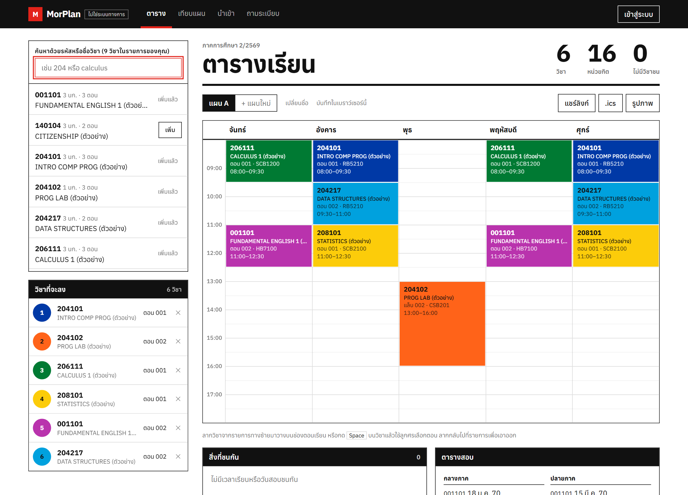
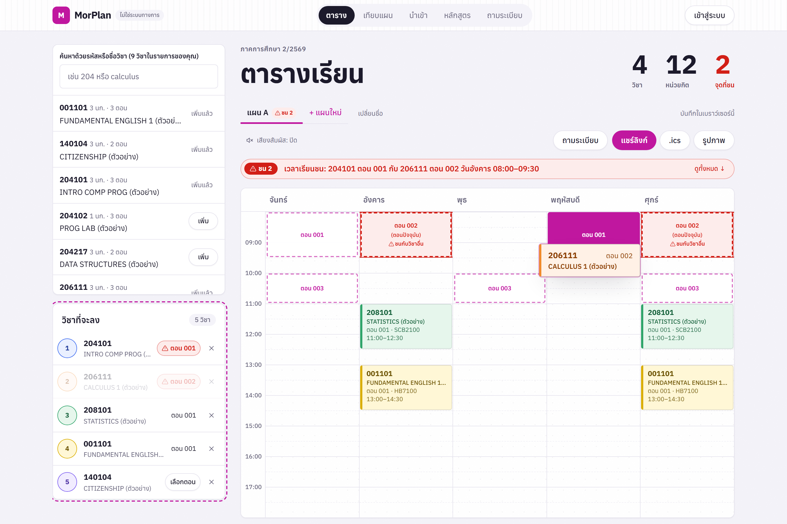
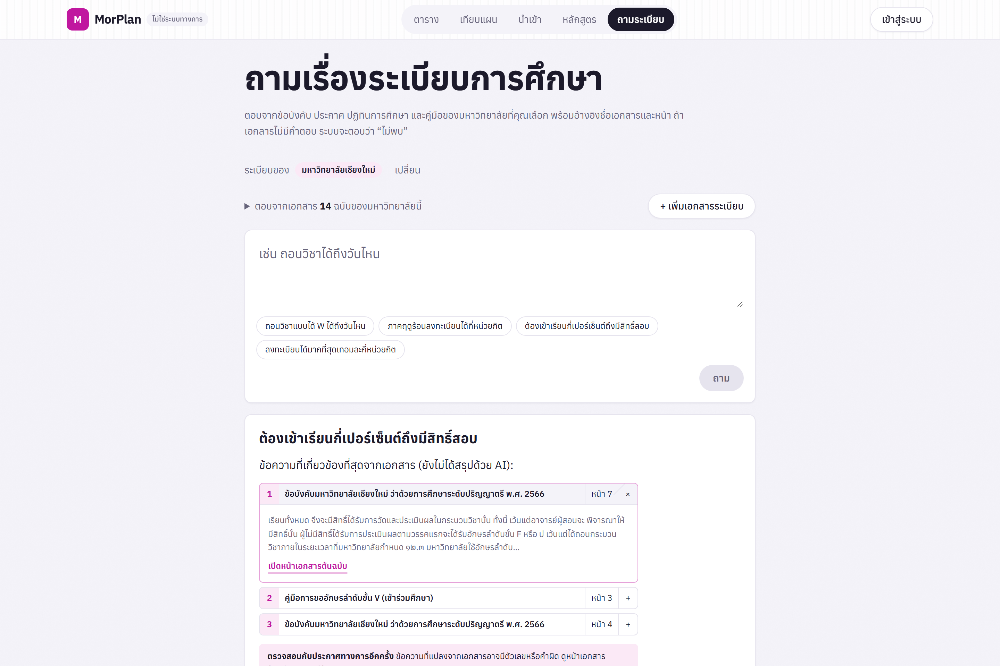
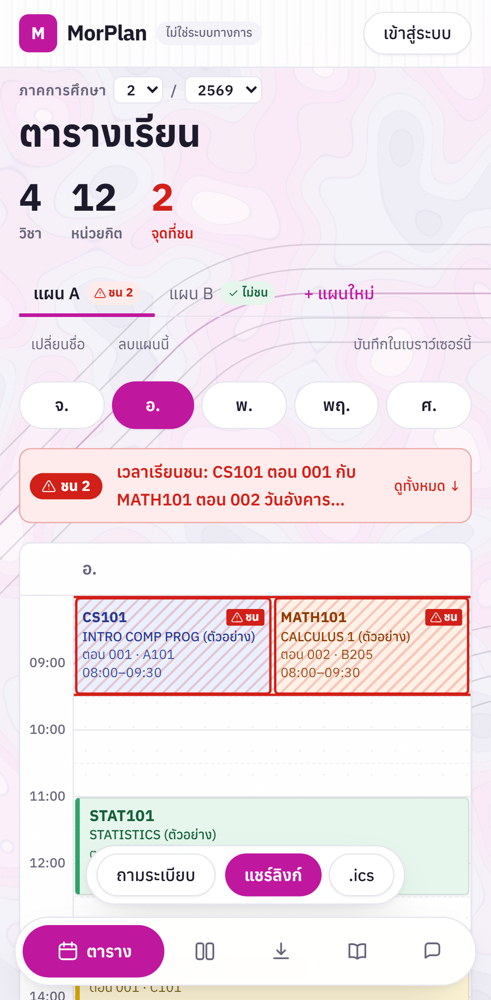

# MorPlan

**Plan a CMU timetable by drag and drop, see class and exam clashes instantly, and ask the university's rules in Thai with page citations.**

**Live:** https://morplan.vercel.app

> ไม่ใช่ระบบทางการของมหาวิทยาลัยเชียงใหม่ — a student project, not affiliated with CMU or its Registration Office.



| Dragging shows every section as a slot (clashes in red) | Rule Q&A with citations | Phone view |
|---|---|---|
|  |  |  |

## What it does

- **Planner.** Drag a course onto the week grid. While you drag, every section of that course appears as a slot, and slots that would clash are red. Drop on one to place it, or drag it back to the list to remove it. It also works from the keyboard: Space picks up, arrows jump between sections, Space drops, Esc cancels, and screen readers get Thai announcements. On a phone you tap to pick a section and browse one day at a time.
- **Clash checks.** Class meetings (lecture and lab are checked separately), midterms, finals, and the same course placed twice are all flagged. Exam slots come from the Registration Office's *public* exam timetable.
- **Plans A–E.** Compare them side by side: credits, clashes, free days, earliest and latest class. Share a read-only link, or export `.ics` (weekly series that skips midterm weeks, plus exam events) or a PNG.
- **Rule Q&A.** Answers questions about the undergraduate regulations, exam and discipline rules, fees, the 2569 academic calendar and the Registration Office's guides. Every answer shows the document title and page with a link to the official PDF. If the answer isn't in the documents it says **"ไม่พบ"**, and every answer ends with "ตรวจสอบกับประกาศทางการอีกครั้ง".

## Where the data comes from (and what MorPlan refuses to do)

- Since PDPA, reg's course search (section, time, room, instructor) needs a reg login. MorPlan never asks for reg/CMU credentials and does not scrape behind the login. The student opens reg in their own browser, copies (or saves) the results page and pastes it into `/import`. Parsing happens in the browser. A manual form covers anything the parser can't read.
- Imported sections stay in the student's browser (or their MorPlan account). They are never pooled into a shared catalogue, so MorPlan doesn't republish what reg stopped publishing.
- The only thing scraped is the public exam timetable (`timetable_exam.php`, allowed by robots.txt): two requests per term with a 2 s gap, cached in `data/exams/`.
- The regulation PDFs are public (`www.reg.cmu.ac.th/webreg/reg-files/…`). `data/docs.json` lists them, the PDFs themselves aren't committed, and the OCR text is in `data/pages.json`.

## RAG evaluation

Ran on 170 Thai questions ([eval/questions.jsonl](eval/questions.jsonl)): 145 answerable, each with a gold document, page and verbatim supporting quote, plus 25 unanswerable (11 of them near-misses such as "graduation ceremony date" or "late-registration fine amount"). Full table: [eval/results/latest.md](eval/results/latest.md).

| chunking | retriever | R@1 | R@5 | R@10 | MRR |
|---|---|---|---|---|---|
| clause | BM25 | 64.8% | 90.3% | 97.9% | 0.755 |
| clause | dense (e5-small) | 53.1% | 82.1% | 91.0% | 0.644 |
| **clause** | **hybrid (RRF)** | 60.0% | **91.7%** | 96.6% | 0.722 |
| paragraph | BM25 | 68.3% | 89.7% | 95.9% | 0.782 |
| fixed 700/150 | hybrid | 61.4% | 87.6% | 96.6% | 0.726 |

Page-level recall; a hit counts only if a retrieved chunk is on a gold page.

- **Hybrid vs. embeddings only:** hybrid adds about 10 points of R@5 over dense alone (91.7% vs 82.1%). On this OCR'd Thai text BM25 is already strong, and with Thai segmentation from `Intl.Segmenter` it beats dense at R@1. Hybrid's gain over BM25 is at R@5.
- **Query rewriting** (everyday words to document vocabulary: เทอม→ภาคการศึกษา, เกรดเฉลี่ย→ค่าลำดับขั้นสะสมเฉลี่ย, รีไทร์→พ้นสภาพ, …): R@5 goes from 89.0% to 91.7%.
- **"ไม่พบ" (abstention):** the threshold is tuned on a dev split and scored on a held-out test split. Top cosine similarity barely separates answerable from unanswerable questions (balanced accuracy 58%). *Query-term coverage* does better: the share of the question's IDF weight found in a top chunk, × cosine. It reaches 77% balanced accuracy, with 75% correct refusals and 21% false refusals. The test split has only 12 unanswerable questions, so treat these numbers as rough.
- **End to end** (extractive mode, test split): 78.8% get the right answer-vs-"ไม่พบ" decision, and 71.2% cite a gold page. Latency is about 8 ms p50 and 10 ms p95 once the model is loaded. Cost is $0 (local embeddings).
- **Production runs the lexical setup** (clause chunks + BM25, coverage ≥ 0.535) because the embedding runtime is too big for a Vercel function. On the same test split it gets the same 78.8% answer-vs-"ไม่พบ" decisions, cites a gold page 69.9% of the time (vs 71.2% for hybrid), and takes ~1 ms per question. Set `RAG_RETRIEVER=bm25` to use it.
- **Not measured yet:** answer *faithfulness* and *correctness* need an LLM judge. The runner does this automatically when `GEMINI_API_KEY` is set, and it also records Gemini cost per question.

Known limitation: the central regulations are scanned images, and Tesseract misreads Thai digits (๔↔๕, ๖/๘→๒). 13 answerable questions have a key number the OCR text gets wrong. They are tagged `ocrMismatch`, which is why every citation links to the original page. The questions were drafted with AI help from the documents. The numbers were checked against rendered page images, and a human should still spot-check them.

## Stack

Next.js 16 (App Router) · TypeScript · Tailwind 4 · @dnd-kit · Supabase (Auth + Postgres + pgvector) · Drizzle · zod · `@huggingface/transformers` (multilingual-e5-small, in process) · Gemini REST (optional) · Tesseract `tha` in Docker for OCR · Vitest + fast-check · Playwright · GitHub Actions.

```
src/lib/core      timetable domain: day patterns, clash detection, reg import parser, exam timetable, .ics
src/lib/workspace plans reducer + browser storage (validated with zod, never throws)
src/lib/rag       Thai tokenizer, chunkers, BM25, embeddings, RRF, coverage signal, answer
src/components    planner UI (calendar, drag & drop, section picker, panels)
ingest/           Dockerised OCR (PyMuPDF + Tesseract) → data/pages.json
eval/             questions, metrics (unit-tested), runner, results
```

## Run it locally

Needs Node 24+ and Docker.

```bash
npm install
npx supabase start -x studio,storage-api,imgproxy,realtime,edge-runtime,logflare,vector,supavisor,postgres-meta
cp .env.example .env.local   # fill keys from `npx supabase status`
npm run db:migrate
npm run index                # chunk + embed the corpus into pgvector (~2 min)
npm run dev -- -p 3100
```

| command | what |
|---|---|
| `npm test` | 104 unit tests (clash detection incl. property tests, parsers, ics, RAG, eval metrics) |
| `npm run test:e2e` | Playwright: mouse drag, keyboard placement + clash, picker, share link, ask, phone view |
| `npm run eval` | RAG evaluation → `eval/results/latest.{json,md}` |
| `npm run fetch:exams 2/2569` | refresh the public exam timetable |
| `docker build -t morplan-ingest ingest && docker run --rm -v "$PWD/data:/data" morplan-ingest` | re-OCR the corpus |

## Status

- Deployed 2026-11-04 to Vercel (`morplan.vercel.app`) with a hosted Supabase project (Auth + Postgres) in ap-southeast-1. The Playwright suite runs against it with `E2E_BASE_URL=https://morplan.vercel.app npm run test:e2e`.
- No real users or usage numbers yet; anonymous counters (imports, shares, questions) are in place.
- The reg import parser was written without a real logged-in results page, because that page isn't public. A saved sample in `samples/` will become a test fixture.
